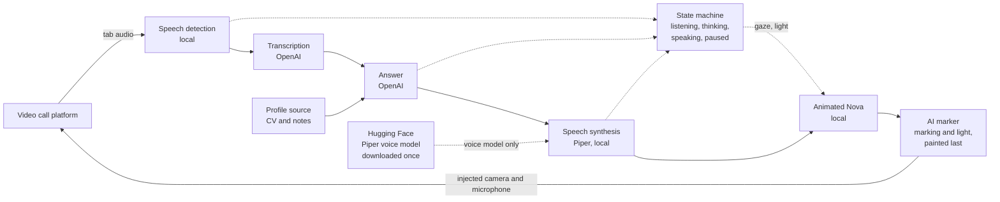

# OtherSelf

*[Version française](README.md)*

A clearly artificial presence that represents you in video calls. This prototype embodies it with Nova, an AI android, and demonstrates it on one specific case: the automated job interview.

[](https://vimeo.com/1250034206)

**[▶ Watch the presentation video](https://vimeo.com/1250034206)**

*The image links to the presentation video (Vimeo), edited from excerpts of a real interview between the prototype and a fictional AI recruiter. The image itself is a video frame sent by the extension (1280 × 720): Nova, a 3D avatar made with VRoid Studio, rendered in the browser. The "AI" marking ("IA" in French) and the status light on the collar (blue: waiting or listening; amber: thinking; green: speaking) are drawn by the code into every frame: the platform cannot hide them. See [License and credits](#license-and-credits).*

> **Status: demo prototype.** This repository accompanies a presentation video. A complete project, usable by anyone without technical skills, will only be developed if the topic draws interest. No support is guaranteed.

> **Warning.** Using OtherSelf in a real job application probably means giving up on the position. Interview platforms may also forbid automated tools in their terms of use.

## OtherSelf: the concept

OtherSelf is an openly artificial presence that represents someone in a video call. It takes the place of your camera and microphone, speaks on your behalf from what you have entrusted to it, and never pretends to be you or to be human.

Transparency is part of the concept, whatever the avatar: an "AI" marking and a status light are embedded in every frame, and the first thing the avatar says is that it is an AI.

## The prototype: Nova, the AI android

The prototype embodies OtherSelf with Nova, a cartoon-style 3D android, deliberately non-human. Nova is a choice of embodiment, not the project: its name is changed in the configuration, and both the 3D model and the background are replaceable files.

What Nova does:

- **Introduces itself first**: "Hello. Before we begin, I want to be transparent: I'm Nova, an AI avatar representing Alex…", then, if you wish, reads a statement you wrote.
- **Shows its state**: the light on its collar is blue when it is waiting or listening, amber when it is thinking, green when it is speaking; it looks away to think and nods when the other person pauses.
- **Answers from your profile**, without making anything up: one concrete example for a "tell me about a time…" question (context, actions, and a measured result if your notes give one), a short answer to a factual question, and an honest sentence when the information is not in your profile. Notes template: [docs/profil.md](docs/profil.md) (in French).
- **Has a tone**: direct, warm, with a touch of wit; it speaks about you in the third person and allows itself at most one light remark about being an AI per interview.
- **Pauses and resumes instantly**: its voice is cut within a few tens of milliseconds and the "AI avatar paused" frame replaces it, with no interruption visible to the platform; on resuming, it reminds the other person in one sentence that it is an AI.
- **Keeps working on a modest machine**: without graphics acceleration, a fallback avatar (pre-rendered images of the same character) takes over automatically, marker included.



The voice is synthesized locally, in the browser, by Piper: only the voice model is downloaded, once, from Hugging Face, and no interview or candidate data is sent to it. Only transcription and answer writing go through the OpenAI API. Nova's state (listening, thinking, speaking, paused) is decided in a single place, then followed by the rendering; the AI marker is painted last into the outgoing frame, so the platform cannot hide it.

Details of the components, of what stays local and of the avatar animation: [docs/architecture.md](docs/architecture.md) (in French).

## The demo: the automated job interview

More and more job interviews are run by an automated system: one AI asks the questions, another scores the answers. The demo turns the situation around: facing an AI recruiter, the candidate answers through their own AI avatar, clearly identified as such. This symmetry makes the case instantly readable, and raises a simple question: if the interview is automated on one side, why not on the other?

During the interview, OtherSelf replaces your camera and microphone, in the interview tab only:

1. Nova listens to the question asked by the platform;
2. it first announces that it is an AI;
3. it can then read a statement you wrote (for example, politely asking for an interview with a human);
4. then it answers the questions from your CV and notes, without making anything up.

## What's next?

Leads, not promises, only if the topic draws interest:

- **Other uses in video calls**: meetings, presentations, any situation where someone wants to be represented by a clearly artificial presence.
- **A profile imported from any source**: CV as a PDF, Notion, a note-taking tool…, converted to the profile format with your review, without invention (every fact must come from the source).
- **A connection to other AI agents**: the answer engine could be replaced by another agent, still bound by the same transparency and no-invention rules.
- **For everyone**: a setup assistant for non-technical users, and a mouth driven by the sounds spoken rather than by the loudness of the voice.

## Design choices

These rules are part of the project and cannot be turned off:

- **AI marker always visible**: in every frame where the avatar appears, the "AI" marking ("IA" in French) is printed on its jacket, close to the face, like a serial number, and its collar tab lights up like a status light: blue when it is waiting or listening, amber when it is thinking, green when it is speaking. They stay visible even when the platform crops the image, and the light never goes out while the avatar is visible. During a pause, the frame shown instead of the avatar says so in plain words ("AI avatar paused"). The deliberately non-human look of the avatar and the spoken disclosure complete this marker.
- **Immediate disclosure**: the avatar's first words announce that it is an AI, with its name if it has one.
- **No stealth mode**: OtherSelf is not meant to deceive a human, nor to feed you answers.
- **Cartoon avatar only**: no photo import, no face or voice cloning; a generic synthetic voice.
- **No invention**: the avatar answers only from your CV and notes, without inventing experience, degrees or figures; when the information is missing, it says so. No tone instruction overrides this rule.
- **Minimal permissions**: the extension acts only on the tab where you activate it (`activeTab` + `scripting`, and `offscreen` for the voice pipeline), never on all sites. To hear the recruiter, it asks you to share that tab, sound included, through Chrome's standard sharing window: no extra permission.

## Try the prototype (developers)

Requirements: Node.js 22, Chrome, an OpenAI API key (transcription and answers) and, for the 3D avatar, WebGL with graphics acceleration (`chrome://gpu`: "WebGL: Hardware accelerated"). Without acceleration, the extension switches automatically to the fallback avatar: pre-rendered images of the same character, lighter (mouth, eyes and marker animated, no head movement).

```
npm install
cp config.example.json config.local.json   # API key, CV, voice…: see docs/config.md
npm run build                              # production build, in .output/chrome-mv3
```

Load `.output/chrome-mv3` in `chrome://extensions` (developer mode, "Load unpacked"). On the interview platform: allow camera and microphone for the site, click "Enable on this tab" in the popup, then the OtherSelf button that appears in the page to share the tab with its sound (this is how the avatar hears the recruiter, without any extension permission). Then pick the "Avatar IA – OtherSelf" microphone in the platform if it did not select it by itself. OpenAI calls are billed to your account.

The configuration guide ([docs/config.md](docs/config.md)) and the developer documentation are in French.

## Compatibility

- **Google Meet**: tested and validated.
- **Microsoft Teams**: works if OtherSelf is enabled before joining the meeting (pre-join screen), not during it.
- **Zoom (browser)**: works intermittently.
- **Other platforms**: not tested.

OtherSelf is a demo prototype: it is not guaranteed to work on any given platform.

## Progress

- Done: rehearsal page, camera and microphone injection, voice pipeline (listening, transcription, answer, speech synthesis, disclosure and configurable statement), embedded AI marker (marking on the jacket and status light on the collar tab), instant pause and resume. Tested on Google Meet.
- Done: Nova in 3D (VRoid model rendered with three.js): lip sync on the voice, blinking, gaze, head movements depending on the state, breathing, hair physics, close-up framing (head and shoulders); automatic fallback avatar, pre-rendered from the same model. Tested on Google Meet.
- Done: personality and answer structure (concrete examples, no invention, direct and warm tone), checked with a text-only question bench.
- Done: presentation video made, from an interview with a fictional AI recruiter page; the videos are re-rendered afterwards from the take's log and recorded voices (a new rendering, using the same drawing code as the extension).

## License and credits

OtherSelf is free software under the [GPL-3.0-or-later](LICENSE) license: the extension embeds the eSpeak NG phonemizer, itself under GPL-3.0. Copyright (C) 2026 Donavan-projects.

Thanks to the projects OtherSelf builds on: [three.js](https://github.com/mrdoob/three.js) and [three-vrm](https://github.com/pixiv/three-vrm) (pixiv) for rendering the 3D avatar, [Piper](https://github.com/rhasspy/piper) and [piper-tts-web](https://github.com/Mintplex-Labs/piper-tts-web) for the synthetic voice, [eSpeak NG](https://github.com/espeak-ng/espeak-ng) for phonemization, [Silero VAD](https://github.com/snakers4/silero-vad) for speech detection, [ONNX Runtime Web](https://github.com/microsoft/onnxruntime) and [WXT](https://github.com/wxt-dev/wxt). Default voice: `en_US-norman-medium`, trained on [LibriVox](https://librivox.org) recordings (public domain), played 1.5 semitones higher without changing the pace. Font of the "AI" marking: [DejaVu Sans Mono](https://dejavu-fonts.github.io/) Bold ([Bitstream Vera](public/fonts/DejaVu-LICENSE.txt) license). License details: [THIRD_PARTY_NOTICES.md](THIRD_PARTY_NOTICES.md) (in French).

**3D avatar.** The character (`avatar/otherself.vrm`) was made with [VRoid Studio](https://vroid.com/en/studio) (pixiv), from the application's built-in parts, then slimmed down for the extension. It is distributed under the [VRM Public License 1.0](https://vrm.dev/licenses/1.0/) (commercial use, redistribution and modification allowed), separate from the code license. VRoid's built-in parts are also subject to the [VRoid Studio terms](https://vroid.pixiv.help/hc/en-us/articles/4405813333657): using a model made with the application is allowed, but an application that generates avatars from those parts requires a separate license from pixiv.

**Fallback avatar.** When the 3D avatar cannot be displayed (no graphics acceleration, loading failure), the extension uses pre-rendered images of the same character made from the model (`avatar/secours/`, `npm run vrm -- fallback`); they are subject to the same terms as the model.

**Backgrounds.** The "atrium" (default, blurred) and "bureau" backgrounds were generated with ChatGPT (OpenAI): raster images cropped and retouched (blur for "atrium", desaturation and lightening for "bureau-clair"), embedded as WebP in an SVG. The AI marker is drawn by the code. These images are provided without any claim of rights; their status is separate from the code license, and the GPL does not apply to them (details: [THIRD_PARTY_NOTICES.md](THIRD_PARTY_NOTICES.md#images)).
