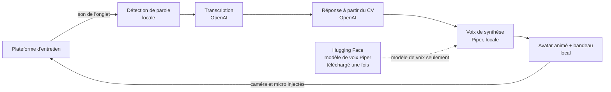

# OtherSelf

Une extension de navigateur qui explore la symétrie des entretiens de recrutement automatisés : face à un recruteur IA, votre propre avatar IA peut répondre en votre nom, en s'identifiant clairement comme une IA.


*Image vidéo envoyée par l'extension (1280 × 720) : avatar 3D créé avec VRoid Studio, rendu dans le navigateur ; le slogan du sweat et le bandeau sont dessinés par le code. Voir [Licence et crédits](#licence-et-crédits).*

> **Statut : prototype de démonstration.** Ce dépôt accompagne une vidéo de démonstration. Un projet complet, utilisable par tous sans compétences techniques, ne sera développé que si le sujet suscite de l'intérêt. Aucun support n'est garanti.

> **Avertissement.** Utiliser OtherSelf dans une vraie candidature, c'est probablement renoncer au poste. Les plateformes d'entretien peuvent aussi interdire les outils automatisés dans leurs conditions d'utilisation.

## Principe

Quand un entretien est mené par un système automatisé, OtherSelf remplace votre caméra et votre micro, dans l'onglet de l'entretien uniquement, par un avatar :

1. il écoute la question posée par la plateforme ;
2. il annonce d'abord qu'il est une IA ;
3. il peut ensuite lire une déclaration que vous avez écrite (par exemple, demander poliment un entretien avec un humain) ;
4. puis il répond aux questions à partir de votre CV et de vos notes, sans rien inventer.



La voix est synthétisée en local, dans le navigateur, par Piper : seul le modèle de voix est téléchargé, une fois, depuis Hugging Face, et aucune donnée de l'entretien ni du candidat ne lui est envoyée. Seules la transcription et la rédaction des réponses passent par l'API OpenAI.

Détail des composants, de ce qui reste local et de l'animation de l'avatar : [docs/architecture.md](docs/architecture.md).

## Choix de conception

Ces règles font partie du projet et ne sont pas désactivables :

- **Bandeau toujours visible** : un bandeau (« Candidat automatisé, comme vous. » par défaut) est dessiné dans chaque image de la vidéo, à un emplacement qui reste visible même quand la plateforme recadre l'image.
- **Révélation immédiate** : la première prise de parole de l'avatar annonce qu'il est une IA.
- **Aucun mode discret** : OtherSelf ne sert pas à tromper un interlocuteur humain, ni à souffler des réponses.
- **Avatar cartoon uniquement** : pas d'import de photo, pas de clonage de visage ni de voix ; voix synthétique générique.
- **Pas d'invention** : l'avatar ne répond qu'à partir de votre CV et de vos notes, sans inventer d'expérience, de diplôme ou de chiffre.
- **Permissions minimales** : l'extension n'agit que sur l'onglet où vous l'activez (`activeTab` + `scripting`, et `offscreen` pour le pipeline voix), jamais sur tous les sites. Pour entendre le recruteur, elle vous demande de partager cet onglet, son compris, par la fenêtre standard de Chrome : aucune permission en plus.

## Essayer le prototype (développeurs)

Prérequis : Node.js 22, Chrome, une clé API OpenAI (transcription et réponses) et, pour l'avatar 3D, WebGL avec accélération graphique (`chrome://gpu` : « WebGL: Hardware accelerated »). Sans accélération, l'extension passe automatiquement à l'avatar 2D (SVG), plus léger.

```
npm install
cp config.example.json config.local.json   # clé API, CV, voix… : voir docs/config.md
npm run build                              # build de production, dans .output/chrome-mv3
```

Chargez `.output/chrome-mv3` dans `chrome://extensions` (mode développeur, « Charger l'extension non empaquetée »). Sur la plateforme d'entretien : autorisez caméra et micro pour le site, cliquez sur « Activer sur cet onglet » dans le popup, puis sur le bouton OtherSelf qui apparaît dans la page pour partager l'onglet avec son son (c'est ainsi que l'avatar entend le recruteur, sans aucune permission d'extension). Choisissez ensuite le micro « Avatar IA – OtherSelf » dans la plateforme si elle ne l'a pas pris d'elle-même. Les appels à OpenAI sont facturés sur votre compte.

## État d'avancement

- Fait : page de répétition, injection caméra et micro, pipeline voix (écoute, transcription, réponse, synthèse vocale, révélation et déclaration configurable), bandeau incrusté, testé sur Google Meet.
- Fait : avatar 3D (modèle VRoid rendu avec three.js) : synchronisation labiale sur la voix, clignements, regard, mouvements de tête, respiration, physique des cheveux, slogan imprimé sur le sweat ; avatar 2D (SVG) en secours automatique. Testé sur Google Meet.
- En cours : tournage de la démo.
- Plus tard, si le sujet intéresse : bouche pilotée par les phonèmes plutôt que par le volume de la voix, assistant de configuration pour les non-techniciens.

## Licence et crédits

OtherSelf est un logiciel libre sous licence [GPL-3.0-or-later](LICENSE) : l'extension embarque le phonémiseur eSpeak NG, lui-même sous GPL-3.0. Copyright (C) 2026 Donavan-projects.

Merci aux projets sur lesquels OtherSelf repose : [three.js](https://github.com/mrdoob/three.js) et [three-vrm](https://github.com/pixiv/three-vrm) (pixiv) pour le rendu de l'avatar 3D, [Piper](https://github.com/rhasspy/piper) et [piper-tts-web](https://github.com/Mintplex-Labs/piper-tts-web) pour la voix de synthèse, [eSpeak NG](https://github.com/espeak-ng/espeak-ng) pour la phonémisation, [Silero VAD](https://github.com/snakers4/silero-vad) pour la détection de parole, [ONNX Runtime Web](https://github.com/microsoft/onnxruntime) et [WXT](https://github.com/wxt-dev/wxt). Voix par défaut : `en_US-norman-medium`, entraînée sur des enregistrements [LibriVox](https://librivox.org) (domaine public), jouée 1,5 demi-ton plus haut sans changer le débit. Police du slogan : [Noto Sans](https://github.com/notofonts/latin-greek-cyrillic) Bold (Google, licence [OFL-1.1](public/fonts/OFL.txt)). Détail des licences : [THIRD_PARTY_NOTICES.md](THIRD_PARTY_NOTICES.md).

**Avatar 3D.** Le personnage (`avatar/otherself.vrm`) a été créé avec [VRoid Studio](https://vroid.com/en/studio) (pixiv), à partir des éléments prédéfinis de l'application, puis allégé pour l'extension. Il est distribué sous [VRM Public License 1.0](https://vrm.dev/licenses/1.0/) (usage commercial, redistribution et modification autorisés), distincte de la licence du code. Les éléments prédéfinis de VRoid relèvent aussi des [conditions de VRoid Studio](https://vroid.pixiv.help/hc/en-us/articles/4405813333657) : utiliser un modèle créé avec l'application est autorisé, mais une application qui génère des avatars à partir de ces éléments demande une licence séparée de pixiv.

**Avatar 2D de secours et fond.** L'avatar SVG sert quand l'avatar 3D ne peut pas être affiché (pas d'accélération graphique, échec du chargement). Les images de ce personnage (v4) et du fond « bureau » ont été générées avec ChatGPT (OpenAI). La tête a été vectorisée à partir de cette image, ramenée à une palette fixe et répartie dans les calques du gabarit. Les parties animées (yeux, clignement, bouches) ont été redessinées à la main. Le fond, commun aux deux avatars, est une image matricielle recadrée et retouchée (désaturée, et éclaircie pour « bureau-clair »), intégrée en WebP dans un SVG. Le texte du t-shirt et le bandeau sont dessinés par le code. Ces images sont mises à disposition sans revendication de droits ; leur statut est distinct de la licence du code, la GPL ne s'applique pas à elles (détail : [THIRD_PARTY_NOTICES.md](THIRD_PARTY_NOTICES.md#images)).
