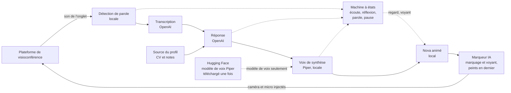

# OtherSelf

*[English version](README.en.md)*

Une présence clairement artificielle qui vous représente en visioconférence. Ce prototype l'incarne avec Nova, un androïde IA, et la démontre sur un cas précis : l'entretien d'embauche automatisé.

[](https://vimeo.com/1250034206)

**[Voir la vidéo de présentation](https://vimeo.com/1250034206)**

*L'image mène à la vidéo de présentation (Vimeo), montée à partir d'extraits d'un entretien réel entre le prototype et un recruteur IA fictif. L'image elle-même est une image envoyée par l'extension (1280 × 720) : Nova, avatar 3D créé avec VRoid Studio, rendu dans le navigateur. Le marquage « AI » (« IA » en français) et le voyant d'état du col (bleu : en attente ou à l'écoute ; ambre : réflexion ; vert : parole) sont dessinés par le code dans chaque image : la plateforme ne peut pas les masquer. Voir [Licence et crédits](#licence-et-crédits).*

> **Statut : prototype de démonstration.** Ce dépôt accompagne une vidéo de présentation. Un projet complet, utilisable par tous sans compétences techniques, ne sera développé que si le sujet suscite de l'intérêt. Aucun support n'est garanti.

> **Avertissement.** Utiliser OtherSelf dans une vraie candidature, c'est probablement renoncer au poste. Les plateformes d'entretien peuvent aussi interdire les outils automatisés dans leurs conditions d'utilisation.

## OtherSelf : le concept

OtherSelf est une présence artificielle assumée qui représente quelqu'un dans une visioconférence. Elle prend la place de votre caméra et de votre micro, parle en votre nom à partir de ce que vous lui avez confié, et ne se fait jamais passer pour vous ni pour un humain.

La transparence fait partie du concept, quel que soit l'avatar choisi : un marquage « IA » et un voyant d'état sont incrustés dans chaque image, et la première chose que dit l'avatar, c'est qu'il est une IA.

## Le prototype : Nova, l'androïde IA

Le prototype incarne OtherSelf avec Nova, un androïde en 3D au style dessin animé, volontairement non humain. Nova est un choix d'incarnation, pas le projet : son nom se change dans la configuration, et le modèle 3D comme le fond sont des fichiers remplaçables.

Ce que fait Nova :

- **Se présente d'abord** : « Hello. Before we begin, I want to be transparent: I'm Nova, an AI avatar representing Alex… », puis, si vous le souhaitez, lit une déclaration que vous avez écrite.
- **Montre son état** : le voyant de son col est bleu quand il attend ou écoute, ambre quand il réfléchit, vert quand il parle ; il détourne le regard pour réfléchir et hoche la tête quand son interlocuteur marque une pause.
- **Répond à partir de votre profil**, sans rien inventer : un exemple concret pour une question du type « racontez une fois où… » (contexte, actions, résultat chiffré si vos notes en donnent un), une réponse courte pour une question factuelle, et une phrase honnête quand l'information n'est pas dans votre profil. Modèle de notes : [docs/profil.md](docs/profil.md).
- **A un ton** : direct, chaleureux, avec un peu d'esprit ; il parle de vous à la troisième personne et s'autorise au plus une remarque légère sur sa condition d'IA par entretien.
- **Se met en pause et reprend instantanément** : sa voix se coupe en quelques dizaines de millisecondes et l'image « Avatar IA en pause » le remplace, sans que la plateforme voie de coupure ; à la reprise, il rappelle en une phrase qu'il est une IA.
- **Reste disponible sur une machine modeste** : sans accélération graphique, un avatar de secours (images du même personnage rendues à l'avance) prend le relais automatiquement, marqueur compris.



La voix est synthétisée en local, dans le navigateur, par Piper : seul le modèle de voix est téléchargé, une fois, depuis Hugging Face, et aucune donnée de l'entretien ni du candidat ne lui est envoyée. Seules la transcription et la rédaction des réponses passent par l'API OpenAI. L'état de Nova (écoute, réflexion, parole, pause) est décidé à un seul endroit, puis suivi par le rendu ; le marqueur IA est peint en dernier dans l'image envoyée, la plateforme ne peut pas le masquer.

Détail des composants, de ce qui reste local et de l'animation de l'avatar : [docs/architecture.md](docs/architecture.md).

## La démo : l'entretien automatisé

De plus en plus d'entretiens d'embauche sont menés par un système automatisé : une IA pose les questions, une autre évalue les réponses. La démo retourne la situation : face à un recruteur IA, le candidat répond par son propre avatar IA, clairement identifié comme tel. Cette symétrie rend le cas immédiatement lisible, et pose une question simple : si l'entretien est automatisé d'un côté, pourquoi pas de l'autre ?

Pendant l'entretien, OtherSelf remplace votre caméra et votre micro, dans l'onglet de l'entretien uniquement :

1. Nova écoute la question posée par la plateforme ;
2. il annonce d'abord qu'il est une IA ;
3. il peut ensuite lire une déclaration que vous avez écrite (par exemple, demander poliment un entretien avec un humain) ;
4. puis il répond aux questions à partir de votre CV et de vos notes, sans rien inventer.

## Et ensuite ?

Des pistes, pas des promesses, seulement si le sujet intéresse :

- **D'autres usages en visioconférence** : réunions, présentations, toute situation où quelqu'un veut se faire représenter par une présence clairement artificielle.
- **Un profil importé depuis n'importe quelle source** : CV en PDF, Notion, outil de notes…, converti au format du profil avec votre relecture, sans invention (chaque fait doit venir de la source).
- **Une connexion à d'autres agents IA** : le moteur de réponse pourrait être remplacé par un autre agent, toujours soumis aux mêmes règles de transparence et de non-invention.
- **Pour tous** : un assistant de configuration pour les non-techniciens, et une bouche pilotée par les sons prononcés plutôt que par le volume de la voix.

## Choix de conception

Ces règles font partie du projet et ne sont pas désactivables :

- **Marqueur IA toujours visible** : dans chaque image où l'avatar apparaît, le marquage « IA » (« AI » en anglais) est imprimé sur sa veste, près du visage, comme un numéro de série, et la languette de son col s'allume comme un voyant : bleu quand il attend ou écoute, ambre quand il réfléchit, vert quand il parle. Ils restent visibles même quand la plateforme recadre l'image, et le voyant ne s'éteint jamais tant que l'avatar est visible. Pendant une pause, l'image affichée à la place de l'avatar l'indique en toutes lettres (« Avatar IA en pause »). L'apparence volontairement non humaine de l'avatar et l'annonce vocale complètent ce marqueur.
- **Révélation immédiate** : la première prise de parole de l'avatar annonce qu'il est une IA, avec son nom s'il en a un.
- **Aucun mode discret** : OtherSelf ne sert pas à tromper un interlocuteur humain, ni à souffler des réponses.
- **Avatar cartoon uniquement** : pas d'import de photo, pas de clonage de visage ni de voix ; voix synthétique générique.
- **Pas d'invention** : l'avatar ne répond qu'à partir de votre CV et de vos notes, sans inventer d'expérience, de diplôme ou de chiffre ; quand l'information manque, il le dit. Aucune consigne de ton ne passe avant cette règle.
- **Permissions minimales** : l'extension n'agit que sur l'onglet où vous l'activez (`activeTab` + `scripting`, et `offscreen` pour le pipeline voix), jamais sur tous les sites. Pour entendre le recruteur, elle vous demande de partager cet onglet, son compris, par la fenêtre standard de Chrome : aucune permission en plus.

## Essayer le prototype (développeurs)

Prérequis : Node.js 22, Chrome, une clé API OpenAI (transcription et réponses) et, pour l'avatar 3D, WebGL avec accélération graphique (`chrome://gpu` : « WebGL: Hardware accelerated »). Sans accélération, l'extension passe automatiquement à l'avatar de secours : images du même personnage rendues à l'avance, plus légères (bouche, yeux et marqueur animés, sans mouvement de tête).

```
npm install
cp config.example.json config.local.json   # clé API, CV, voix… : voir docs/config.md
npm run build                              # build de production, dans .output/chrome-mv3
```

Chargez `.output/chrome-mv3` dans `chrome://extensions` (mode développeur, « Charger l'extension non empaquetée »). Sur la plateforme d'entretien : autorisez caméra et micro pour le site, cliquez sur « Activer sur cet onglet » dans le popup, puis sur le bouton OtherSelf qui apparaît dans la page pour partager l'onglet avec son son (c'est ainsi que l'avatar entend le recruteur, sans aucune permission d'extension). Choisissez ensuite le micro « Avatar IA – OtherSelf » dans la plateforme si elle ne l'a pas pris d'elle-même. Les appels à OpenAI sont facturés sur votre compte.

## Compatibilité

- **Google Meet** : testé et validé.
- **Microsoft Teams** : fonctionne si OtherSelf est activé avant d'entrer en réunion (écran d'avant-réunion), pas pendant.
- **Zoom (navigateur)** : fonctionnement aléatoire.
- **Autres plateformes** : non testées.

OtherSelf est un prototype de démonstration : aucun fonctionnement n'est garanti sur une plateforme donnée.

## État d'avancement

- Fait : page de répétition, injection caméra et micro, pipeline voix (écoute, transcription, réponse, synthèse vocale, révélation et déclaration configurable), marqueur IA incrusté (marquage sur la veste et voyant d'état sur la languette du col), pause et reprise instantanées. Testé sur Google Meet.
- Fait : Nova en 3D (modèle VRoid rendu avec three.js) : synchronisation labiale sur la voix, clignements, regard, mouvements de tête selon l'état, respiration, physique des cheveux, plan serré (tête et épaules) ; avatar de secours automatique, rendu à l'avance depuis le même modèle. Testé sur Google Meet.
- Fait : personnalité et structure des réponses (exemples concrets, aucune invention, ton direct et chaleureux), vérifiées par un banc de questions en texte.
- Fait : vidéo de présentation réalisée, à partir d'un entretien avec une page de recruteur IA fictive ; les vidéos sont refaites après coup à partir du journal de la prise et des voix enregistrées (nouveau rendu, même code de dessin que dans l'extension).

## Licence et crédits

OtherSelf est un logiciel libre sous licence [GPL-3.0-or-later](LICENSE) : l'extension embarque le phonémiseur eSpeak NG, lui-même sous GPL-3.0. Copyright (C) 2026 Donavan-projects.

Merci aux projets sur lesquels OtherSelf repose : [three.js](https://github.com/mrdoob/three.js) et [three-vrm](https://github.com/pixiv/three-vrm) (pixiv) pour le rendu de l'avatar 3D, [Piper](https://github.com/rhasspy/piper) et [piper-tts-web](https://github.com/Mintplex-Labs/piper-tts-web) pour la voix de synthèse, [eSpeak NG](https://github.com/espeak-ng/espeak-ng) pour la phonémisation, [Silero VAD](https://github.com/snakers4/silero-vad) pour la détection de parole, [ONNX Runtime Web](https://github.com/microsoft/onnxruntime) et [WXT](https://github.com/wxt-dev/wxt). Voix par défaut : `en_US-norman-medium`, entraînée sur des enregistrements [LibriVox](https://librivox.org) (domaine public), jouée 1,5 demi-ton plus haut sans changer le débit. Police du marquage « IA » : [DejaVu Sans Mono](https://dejavu-fonts.github.io/) Bold (licence [Bitstream Vera](public/fonts/DejaVu-LICENSE.txt)). Détail des licences : [THIRD_PARTY_NOTICES.md](THIRD_PARTY_NOTICES.md).

**Avatar 3D.** Le personnage (`avatar/otherself.vrm`) a été créé avec [VRoid Studio](https://vroid.com/en/studio) (pixiv), à partir des éléments prédéfinis de l'application, puis allégé pour l'extension. Il est distribué sous [VRM Public License 1.0](https://vrm.dev/licenses/1.0/) (usage commercial, redistribution et modification autorisés), distincte de la licence du code. Les éléments prédéfinis de VRoid relèvent aussi des [conditions de VRoid Studio](https://vroid.pixiv.help/hc/en-us/articles/4405813333657) : utiliser un modèle créé avec l'application est autorisé, mais une application qui génère des avatars à partir de ces éléments demande une licence séparée de pixiv.

**Avatar de secours.** Quand l'avatar 3D ne peut pas être affiché (pas d'accélération graphique, échec du chargement), l'extension utilise des images du même personnage rendues à l'avance à partir du modèle (`avatar/secours/`, `npm run vrm -- fallback`) ; elles relèvent des mêmes conditions que le modèle.

**Fonds.** Les fonds « atrium » (par défaut, flouté) et « bureau » ont été générés avec ChatGPT (OpenAI) : images matricielles recadrées et retouchées (flou pour « atrium », désaturation et éclaircissement pour « bureau-clair »), intégrées en WebP dans un SVG. Le marqueur IA est dessiné par le code. Ces images sont mises à disposition sans revendication de droits ; leur statut est distinct de la licence du code, la GPL ne s'applique pas à elles (détail : [THIRD_PARTY_NOTICES.md](THIRD_PARTY_NOTICES.md#images)).
