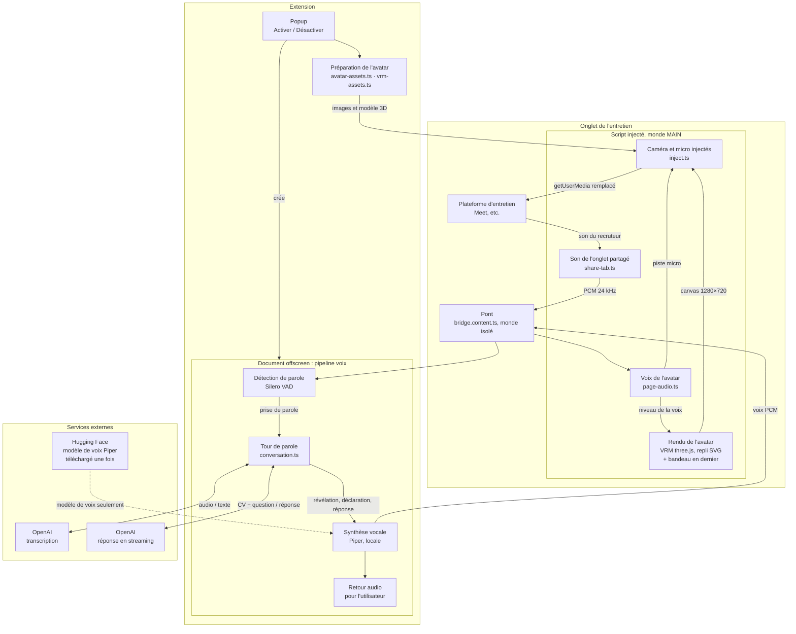
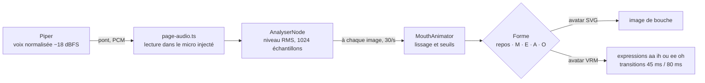

# Architecture d'OtherSelf

OtherSelf est une extension Chrome (Manifest V3, WXT) sans serveur. Elle travaille dans trois contextes :

- les **pages de l'extension** : le popup, qui prépare l'avatar et lance tout le reste ;
- l'**onglet de l'entretien**, où un script injecté à la demande remplace la caméra et le micro, et où un pont relaie
  le son ;
- le **document offscreen** de l'extension, qui fait tourner le pipeline voix.

Seules la transcription et la rédaction des réponses passent par l'API OpenAI ; le reste tourne dans le navigateur. La
voix est synthétisée en local par Piper : seul son modèle est téléchargé, une fois, depuis Hugging Face, sans qu'aucune
donnée de l'entretien ni du candidat soit envoyée.

## Vue d'ensemble

### Popup et préparation de l'avatar

`entrypoints/popup/main.ts`. Au clic sur « Activer sur cet onglet », le popup lit `config.local.json` (copié dans le
build sous `local/`), puis prépare l'avatar :

- `lib/avatar-assets.ts` construit toujours l'avatar SVG (calques rastérisés, slogan courbé sur le t-shirt) : c'est le
  secours ;
- `lib/vrm-assets.ts` (rendu `vrm`, par défaut) lit `avatar/otherself.vrm`, calcule le cadrage d'après les os du
  squelette (`lib/vrm-frame.ts`), dessine le slogan à plat avec les paramètres du SVG (zone, lignes, police, encre) et
  rastérise le fond.

Le popup injecte ensuite `content.js` (monde MAIN) et `bridge.js` (monde isolé) dans l'onglet actif, avec
`scripting.executeScript` : la page reçoit des images et le modèle 3D, jamais la configuration ni la clé API. Il crée
enfin le document offscreen. Permissions : `activeTab`, `scripting`, `offscreen`, rien d'autre.

### Pipeline voix

Dans le document offscreen (`entrypoints/offscreen/main.ts`, `lib/conversation.ts`).

- **Écoute** : le bouton OtherSelf injecté dans la page ouvre la fenêtre de partage standard de Chrome sur l'onglet
  courant, son compris (`lib/share-tab.ts`). La vidéo du partage est arrêtée aussitôt ; le son, c'est-à-dire ce que la
  plateforme joue vraiment, part en PCM 24 kHz vers le document offscreen par le pont. Il ne contient ni le micro de
  l'utilisateur ni la voix de l'avatar.
- **Détection de parole** : Silero VAD v5 en WebAssembly (`lib/vad.ts`) découpe le son en prises de parole ; la fin
  d'une question est un silence de `silenceMs` (800 ms).
- **Transcription** : session Realtime d'OpenAI (`gpt-live-transcribe`), alimentée pendant que le recruteur parle ; repli
  sur `/v1/audio/transcriptions` (`gpt-transcribe`) (`lib/stt.ts`).
- **Réponse** : Chat Completions en streaming (`gpt-5.6-luna`), avec un prompt système qui contient le CV et les notes et
  interdit d'inventer (`lib/llm.ts`, `lib/prompt.ts`).
- **Synthèse vocale** : Piper en WebAssembly dans un worker (`lib/tts.ts`), morceau par morceau au fil du streaming
  (`lib/chunks.ts`), voix normalisée à −18 dBFS. Le modèle de voix est téléchargé une seule fois depuis Hugging Face
  (simple téléchargement de fichier, aucune donnée de l'entretien ni du candidat envoyée), puis gardé dans le stockage
  privé de l'extension ; la synthèse se fait ensuite entièrement en local.
- **Révélation et déclaration** : à la fin de la première prise de parole du recruteur, l'avatar annonce qu'il est une
  IA, puis lit `messageText` s'il est configuré, avant toute réponse ; ce texte ne passe pas par le LLM.
- **Retour** : la voix repart vers la page par le pont, et l'utilisateur l'entend par le document offscreen
  (`lib/monitor.ts`), jamais par les haut-parleurs de l'onglet, dont le son est partagé.

### Rendu de l'avatar et bandeau

Dans la page (`lib/inject.ts`), à la première demande de caméra :

- **VRM** (`lib/avatar-vrm.ts`) : three.js et three-vrm dessinent le modèle dans un canvas WebGL hors DOM, à fond
  transparent. Il est recopié à chaque image dans le canvas 2D de 1280×720, par-dessus le fond.
- **Repli SVG** (`lib/avatar.ts`) : si WebGL est logiciel (SwiftShader, llvmpipe), si le modèle ne se charge pas ou si le
  contexte WebGL est perdu, l'avatar SVG prend le relais dans le même canvas, sans changer de piste vidéo.
- **Bandeau** : peint en dernier dans le canvas 2D, à chaque image, dans la zone de sécurité qui survit aux recadrages.
  Il fait partie de l'image envoyée : la plateforme ne peut pas le masquer.

### Injection de la caméra et du micro

`lib/inject.ts` remplace `getUserMedia` et `enumerateDevices` dans l'onglet, et propose un faux périphérique « Avatar IA
– OtherSelf ». La caméra est le canvas capturé à 30 images/s (`captureStream`). Le micro est une piste Web Audio où
`lib/page-audio.ts` joue la voix de l'avatar. La plateforme reçoit des pistes ordinaires. Désactiver l'extension remet
les fonctions d'origine et coupe les pistes.

### Ce qui reste local, ce qui passe par OpenAI

| Local, dans le navigateur | API OpenAI (clé de l'utilisateur, à ses frais) |
| --- | --- |
| Partage du son de l'onglet, routage audio, pont | Transcription : son du recruteur pendant ses prises de parole |
| Détection de parole (Silero VAD) | Réponse : prompt système avec le CV et les notes, transcription des questions |
| Synthèse vocale (Piper, modèle téléchargé une fois depuis Hugging Face), retour audio | Synthèse vocale OpenAI seulement si `ttsProvider` vaut `openai` (pas par défaut) |
| Rendu de l'avatar (WebGL ou SVG), bandeau, injection | |

La clé API ne quitte jamais le document offscreen. Hugging Face ne sert qu'à télécharger le modèle de voix Piper, une
fois, sans clé ni donnée de l'entretien ou du candidat (comme toute requête web, ce téléchargement fait connaître
l'adresse IP) ; le modèle est ensuite gardé dans le stockage privé de l'extension et la synthèse se fait en local.

## Animation de l'avatar

### Du son de la voix à la bouche

Le niveau est mesuré sur la piste du micro injecté, c'est-à-dire sur la voix réellement envoyée à la plateforme : la
bouche suit ce qu'entend le recruteur, sans décalage dû à la synthèse ou au pont.

`MouthAnimator` (`lib/avatar.ts`) lisse ce niveau (montée rapide, coefficient 0,6 par image ; descente 0,35), puis
choisit une forme :

| Niveau lissé (RMS) | Forme |
| --- | --- |
| moins de 0,015 | repos |
| 0,015 à 0,035 | M (lèvres fermées) |
| 0,035 à 0,095 | E |
| 0,095 et plus | A ou O, en alternance à chaque nouvelle ouverture |

Une forme est gardée au moins 70 ms, pour éviter le scintillement.

L'avatar VRM traduit chaque forme en poids d'expressions VRM (`lib/avatar-vrm.ts`) :

| Forme | aa | ih | ou | ee | oh |
| --- | --- | --- | --- | --- | --- |
| repos | 0 | 0 | 0 | 0 | 0 |
| M | 0 | 0 | 0 | 0 | 0 |
| E | 0 | 0,3 | 0 | 0,6 | 0 |
| A | 0,8 | 0 | 0 | 0 | 0 |
| O | 0 | 0 | 0,2 | 0 | 0,7 |

Chaque poids rejoint sa cible de façon exponentielle : constante de temps de 45 ms à l'ouverture, de 80 ms à la
fermeture. Les formes s'enchaînent donc sans saut.

### Yeux, tête, corps

- **Clignements** : toutes les 2,5 à 6 s, yeux fermés 110 ms, parfois deux de suite (15 %, 180 ms d'écart). L'avatar VRM
  ferme les paupières en 25 ms environ et les rouvre en 50 ms (expression `blink`).
- **Regard** : vers la caméra, par les os des yeux du modèle. Toutes les 1,2 à 3,5 s, une petite saccade (jusqu'à 1,5°
  horizontalement et 1° verticalement). Une fois sur sept environ, un bref coup d'œil de côté et vers le haut (5 à 9°,
  1 à 5°), comme pour réfléchir, pendant 0,5 à 1,1 s. Les yeux se déplacent en une trentaine de millisecondes.
- **Tête** : dérive lente au repos (sinusoïdes de 0,04 à 0,3 Hz, jusqu'à 2,2° de rotation, 1,4° d'inclinaison avant,
  1,2° de côté). Elle suit un peu le regard et, quand l'avatar parle, ajoute de légers hochements (1,6 à 2,7 Hz). Le
  mouvement est réparti entre le cou (40 %) et la tête (60 %).
- **Respiration** : environ 14 respirations par minute au repos, 19 en parlant. La poitrine se soulève (jusqu'à 0,9°),
  les épaules montent de 0,7°, et les bras compensent pour que les mains ne bougent pas. Le buste se balance très
  légèrement (moins de 1°).
- **Pose des bras** : VRoid exporte en T-pose ; les bras sont baissés le long du corps (72°), coudes à peine pliés.
- **Cheveux** : physique du modèle (spring bones VRM, 73 articulations), mise à jour à chaque image. Avant la première
  image, 60 images de physique laissent les cheveux retomber depuis la T-pose.

### Partagé avec l'avatar SVG, propre au VRM

| Partagé | Propre au VRM |
| --- | --- |
| Mesure du niveau de la voix et choix de la forme de bouche (`MouthAnimator`) | Poids des expressions et transitions lissées |
| Rythme des clignements (`BlinkAnimator`) | Fermeture progressive des paupières |
| Bandeau, zone de sécurité, cadrage (haut de la tête à y = 94) | Regard, saccades, mouvements de tête, respiration, pose des bras, physique des cheveux |
| Paramètres du slogan (zone, lignes, police Noto Sans Bold, encre) | Slogan imprimé dans la texture du sweat, sur le personnage posé |

L'avatar SVG n'a que des formes de bouche dessinées et des yeux ouverts ou fermés ; il ne redessine que la zone des
yeux et de la bouche à chaque image.

### Limites actuelles

- **Synchronisation par le volume, pas par les phonèmes** : la bouche s'ouvre selon l'intensité de la voix, pas selon le
  son prononcé. Un « o » fort peut donner la forme A, l'alternance A / O est arbitraire, et les lèvres ne se ferment pas
  sur les « m », « b » ou « p » au milieu d'un mot.
- **Piste reportée** : piloter la bouche par le texte. piper-tts-web ne renvoie que l'audio, et les voix Piper standard
  ne donnent pas la durée des phonèmes. Il faudra soit réexporter la voix avec les durées, soit aligner les phonèmes sur
  l'audio, puis associer chaque phonème à une expression VRM, synchronisée sur la lecture réelle de la voix.
