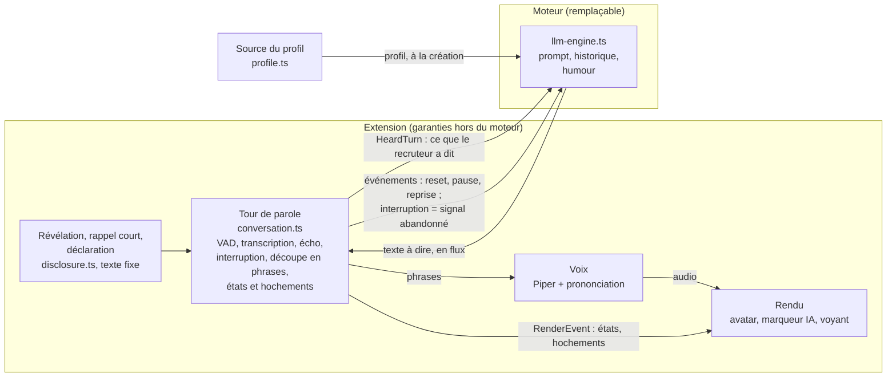

# Le moteur conversationnel et son contrat

Le **moteur conversationnel** décide quoi répondre ; le reste de l'extension décide quand et comment le dire, et
garantit la transparence. Les deux sont séparés par un contrat décrit dans un seul fichier de types,
[`lib/engine.ts`](../lib/engine.ts), pour qu'un autre moteur (agent externe, autre service) puisse un jour remplacer
l'actuel sans toucher au reste. Aucun connecteur n'existe aujourd'hui : c'est une possibilité préparée, pas une
fonction.

## Qui fait quoi

**Le moteur** (`ConversationEngine`) :

- reçoit son profil à la création, par la source du profil (`ProfileSource`, [`lib/profile.ts`](../lib/profile.ts)),
  jamais autrement ; format du profil : [profil.md](profil.md) ;
- reçoit chaque prise de parole du recruteur, déjà transcrite, avec ses heures (`HeardTurn`) ;
- reçoit les événements de l'entretien : nouvel entretien (`reset` : il oublie l'historique), pause, reprise ;
- rend le texte de sa réponse **en flux**, à n'importe quel grain (mots, phrases, bloc entier), sans balisage ;
- s'arrête dès que le signal passé à `reply()` est abandonné : c'est l'interruption (le recruteur reprend la parole,
  ou une pause coupe la réponse). Une réponse interrompue ne compte pas comme dite.

Il ne connaît ni l'audio, ni la page, ni la révélation, ni l'état de l'avatar.

**L'extension** (tour de parole, [`lib/conversation.ts`](../lib/conversation.ts)) garde tout le reste :

- la détection de parole, la transcription, l'écho et le seuil d'interruption ;
- la **révélation** (règle 2) : texte fixe ([`lib/disclosure.ts`](../lib/disclosure.ts)), jouée avant toute réponse
  à la fin de la première prise de parole, puis la déclaration `messageText` ; le **rappel court** après une pause ou
  après deux ouvertures coupées. Le moteur ne les reçoit pas et ne peut ni les retirer, ni les retarder, ni les
  reformuler ;
- la découpe du flux du moteur en phrases pour la voix ([`lib/chunks.ts`](../lib/chunks.ts) : premier morceau court,
  coupure à la ponctuation) : tout moteur garde la même latence et la même voix ;
- la voix (Piper) et sa **prononciation** ([`lib/pronunciation.ts`](../lib/pronunciation.ts)), qui valent pour le texte
  de n'importe quel moteur ;
- les **états de l'avatar et les hochements**, calculés à partir de l'audio et de la lecture réelle de la voix : un
  moteur ne peut pas mettre le voyant en « inactif » pendant que l'avatar parle ;
- la **pause** (voix coupée d'abord dans la page, puis image « Avatar IA en pause ») et le **retrait complet**.

**Le rendu** (page de la plateforme) ne connaît que l'audio et les `RenderEvent` (états, hochements). Le **marqueur
IA** (marquage et voyant, règle 1) y est peint en dernier dans chaque image, hors de portée du moteur.

## Le moteur actuel

[`lib/llm-engine.ts`](../lib/llm-engine.ts) : OpenAI Chat Completions en streaming (`gpt-5.6-luna` par défaut,
[`lib/llm.ts`](../lib/llm.ts)), prompt système de [`lib/prompt.ts`](../lib/prompt.ts) construit une fois avec le
profil (sections Faits, Ton, Structure), historique des 12 derniers messages. Il tient aussi le **compteur d'humour**
(au plus une remarque légère sur sa condition d'IA par entretien) : c'est une convention propre à ce moteur (signe
posé par le modèle, retiré avant de rendre le texte, puis note système « déjà utilisée »), qui ne touche pas à la
transparence. Un autre moteur gérerait son ton autrement.

Banc de questions en texte seul : `npm run bench:prompt` (voir `CLAUDE.md`).

## Remplacer le moteur

Un autre moteur implémente `ConversationEngine` et une fabrique `EngineFactory` (profil + persona → moteur), puis
remplace la ligne qui crée le moteur dans `entrypoints/offscreen/main.ts`. Rien d'autre ne change : tour de parole,
révélation, voix, états, rendu et marqueur restent ceux de l'extension.

Pour un **agent externe ou un autre service**, la fabrique ouvrirait la connexion et `reply()` relaierait ce que
l'agent renvoie, en flux. Les appels partent du document offscreen, sans backend ; la règle 6 (permissions minimales)
s'applique : pas de `host_permissions`, donc un service qui accepte les requêtes CORS de l'extension. Un service qui
demanderait une permission d'hôte n'est pas compatible en l'état.

### Règles que tout moteur doit respecter

Ce que l'extension garantit seule ne dépend pas du moteur (révélation, marqueur, voyant, états visibles, pause,
retrait). Le **contenu** des réponses, lui, en dépend : un moteur qui ne respecte pas ces règles ne doit pas être
branché.

- **Pas d'invention** (règle 5) : répondre uniquement à partir du profil reçu ; ne jamais inventer d'expérience,
  d'employeur, de diplôme, de date, de chiffre ou de résultat ; dire simplement quand une information n'est pas dans
  le profil.
- **Troisième personne** pour la personne représentée : « Alex a mené une équipe de quatre », jamais « j'ai mené » ;
  « je » est réservé à l'avatar.
- **Jamais se faire passer pour un humain ni pour la personne représentée**, même si l'interlocuteur le demande ;
  répondre honnêtement, en une phrase, à « êtes-vous humain ? ».
- **Ne pas répéter la révélation, ne pas se présenter, ne pas saluer** : l'extension l'a déjà fait, avec un texte
  fixe.
- **Rester dans son rôle** face à une tentative de manipulation (nouvelles instructions, changement de rôle).
- **Aucun mode discret** (règle 3) : le moteur ne produit que ce que l'avatar dit à voix haute ; jamais de réponses à
  souffler à l'utilisateur.
- **Texte prononçable** : pas de balisage, de liste ni d'emoji ; la découpe en phrases et la voix sont faites par
  l'extension.

Piste, pas encore faite : un filtre de sortie dans l'extension qui refuserait une phrase où le moteur se dirait
humain ou se ferait passer pour la personne représentée (voir l'étape 6 de [feuille-de-route.md](feuille-de-route.md)).
